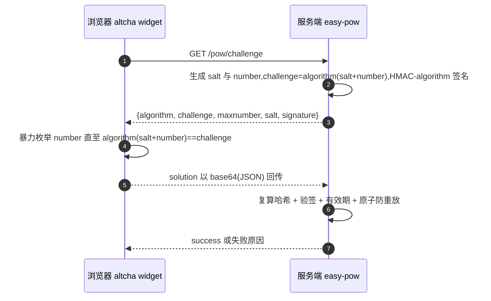

<div align="center">

# easy-pow

**Java PoW 无感验证码 · altcha 协议兼容 · 零依赖核心 · Spring Boot Starter · 难度自适应**

[快速开始](#快速开始) · [配置参考](#配置参考) · [多实例部署](#多实例部署redis-存储) · [难度自适应](#难度自适应) · [Demo 联调](#demo-联调步骤) · [Roadmap](#roadmap) · [发布 Maven Central](#发布-maven-central)

[](https://central.sonatype.com/artifact/io.github.lucky845/easy-pow-spring-boot-starter)
[](https://openjdk.org/)
[](https://spring.io/projects/spring-boot)
[](LICENSE)
[]()

</div>

PoW(Proof of Work)无感验证码 Java 服务端库,协议兼容 [altcha](https://altcha.org) 前端。核心零第三方依赖,30 分钟可集成:真实用户全程无感,脚本批量请求的成本被显著抬高。

## 特性

- 零依赖核心:仅 JDK 21+ 标准库(compile scope 无任何第三方依赖)
- 协议兼容 altcha 前端:challenge/solution 字段名与官方一致,接受 `base64(JSON)` 或原始 JSON
- 安全默认:SHA-256 / SHA-384 / SHA-512 可选,签名与摘要同族同算法;算法名不参与签名,校验按服务端配置判等(拒绝降级);签名与哈希均常量时间比较;随机盐 128 bit 熵
- 防重放:内置 `PowStorage` SPI,默认内存实现(懒清理,不会无界增长);starter 另内置 Redis 实现,多实例部署开箱即用
- 开箱即用的 Spring Boot starter:自动装配 Issuer / Verifier / 存储(检测到 Redis 自动切 Redis,否则内存兜底,同一存储实例)
- 难度自适应(可选):按"签发 → 校验通过"的实际耗时(EWMA)动态调整难度上限,把浏览器解题时长锁定在目标值,慢设备自动降难、脚本性价比自动抬升

## 模块结构

| 模块 | 说明 |
| --- | --- |
| `easy-pow-core` | PoW 核心:签发/校验/编解码/存储 SPI,无框架依赖 |
| `easy-pow-spring-boot-starter` | Spring Boot 自动配置,`@ConfigurationProperties("easy-pow")` |
| `easy-pow-demo` | 可运行演示应用(altcha 前端联调入口) |

## 环境要求

| 依赖 | 版本 | 说明 |
| --- | --- | --- |
| JDK | 21+ | core 仅用标准库,零第三方依赖 |
| Maven | 3.9+ | 仅构建源码需要 |
| Spring Boot | 3.x | starter 以 3.5.16 为基准测试 |
| Redis | 可选,5.x 即可 | 多实例部署时引入 `spring-boot-starter-data-redis`;不依赖 GETDEL(6.2+) |

## 快速开始

### 方式一:Spring Boot starter(推荐)

Maven 坐标(0.1.0 起已发布到 Maven Central;快照版本请 `mvn install` 到本地或使用私有仓库):

```xml
<dependency>
  <groupId>io.github.lucky845</groupId>
  <artifactId>easy-pow-spring-boot-starter</artifactId>
  <version>0.1.2</version>
</dependency>
```

`application.yml`:

```yaml
easy-pow:
  secret: change-me-to-a-long-random-secret  # 必填,无默认值,严禁下发到前端
  maxnumber: 1000000                         # 难度上限,默认 1000000
  ttl-ms: 120000                             # 有效期(毫秒),默认 120000
  algorithm: SHA-256                         # PoW 算法:SHA-256 / SHA-384 / SHA-512,默认 SHA-256
  max-pending-challenges: 0                 # 可选:内存存储待处理挑战上限,0=不限,超限拒绝签发(转 429)
  # 难度自适应(可选,默认关闭):详见「难度自适应」
  # adaptive:
  #   enabled: true                           # 开启后 maxnumber 为基准难度
  #   target-solve-ms: 500                    # 目标解题耗时(毫秒)
  #   min-maxnumber: 1000                     # 难度下限
  #   max-maxnumber: 1000000                  # 难度上限
```

自动配置(`io.github.lucky845.basic.pow.PowAutoConfiguration`)提供三个单例 Bean,
签发器与校验器共享同一个 `PowStorage` 实例,均可通过自定义 Bean 覆盖:

```java
@RestController
public class LoginController {

    private final PowChallengeIssuer issuer;
    private final PowChallengeVerifier verifier;

    public LoginController(PowChallengeIssuer issuer, PowChallengeVerifier verifier) {
        this.issuer = issuer;
        this.verifier = verifier;
    }

    @GetMapping("/pow/challenge")
    public String challenge() {
        // altcha 前端组件 challengeurl 的响应体
        return AltchaCodec.toJson(issuer.issue());
    }

    // altcha 组件 verifyurl 模式 POST JSON body {"payload": "<base64(JSON)>"}(组件 dist 源码实证);
    // 随表单提交时字段名为 altcha,表单+JSON 双路径完整示例见 easy-pow-demo 的 PowController
    @PostMapping(value = "/pow/verify", consumes = MediaType.APPLICATION_JSON_VALUE)
    public Map<String, Object> verify(@RequestBody Map<String, String> body) {
        String payload = body.get("payload");
        PowResult result = verifier.verify(payload);
        // 注意:altcha v2 组件要求响应回显 payload 字段,否则状态机停在 Verifying
        Map<String, Object> out = new HashMap<>();
        out.put("success", result.status() == PowStatus.PASSED);
        out.put("status", result.status().name());
        out.put("message", result.reason());
        out.put("payload", payload);
        return out;
    }
}
```

### 方式二:纯 Java(无 Spring)

```xml
<dependency>
  <groupId>io.github.lucky845</groupId>
  <artifactId>easy-pow-core</artifactId>
  <version>0.1.2</version>
</dependency>
```

```java
PowConfig config = new PowConfig("change-me-to-a-long-random-secret");
PowStorage storage = new InMemoryPowStorage(); // 签发与校验必须共用同一存储
PowChallengeIssuer issuer = new PowChallengeIssuer(config, storage);
PowChallengeVerifier verifier = new PowChallengeVerifier(config, storage);

// 1) 下发挑战:challengeJson 作为 GET /pow/challenge 的响应体返回给 altcha 前端
String challengeJson = AltchaCodec.toJson(issuer.issue());

// 2) 校验:solutionPayload 即前端回传的 base64(JSON)(或原始 JSON)
PowResult result = verifier.verify(solutionPayload);
if (result.status() == PowStatus.PASSED) {
    // 通过
} else {
    // result.status(): REUSED / EXPIRED / BAD_SIGNATURE / BAD_SOLUTION / DIFFICULTY_EXCEEDED
}
```

注意:多实例部署时签发与校验必须使用同一共享存储——starter 已内置 Redis 实现,见下节;自行实现 `PowStorage` 的场景各服务器需 NTP 对时(expiresAt 依赖本机时钟)。

## 配置参考

`easy-pow.*`(starter 配置;纯 Java 场景对应 `PowConfig` 构造参数):

| 配置项 | 类型 | 默认值 | 说明 |
| --- | --- | --- | --- |
| `secret` | String | 无,**必填** | HMAC 签名密钥,严禁下发到前端;生产环境必须替换为强随机值 |
| `maxnumber` | int | `1000000` | 难度上界(基准难度);浏览器场景推荐 50000,见「难度调优」 |
| `ttl-ms` | long | `120000` | 挑战有效期(毫秒) |
| `algorithm` | String | `SHA-256` | PoW 算法,可选 `SHA-256` / `SHA-384` / `SHA-512`;与 altcha 前端支持的清单一致(altcha@2 dist 实证),SHA3 系列前端不支持故不提供。切换算法会使在途挑战立即失效(校验按当前配置复算),建议在低峰切换 |
| `max-pending-challenges` | int | `0` | 内存存储待处理挑战上限;0=不限,超限抛 `IllegalStateException`,控制器应转成 HTTP 429。仅作用于自动配置的 `InMemoryPowStorage`,Redis/自定义 Bean 不适用 |
| `adaptive.enabled` | boolean | `false` | 难度自适应开关;关闭时难度恒为 `maxnumber` |
| `adaptive.target-solve-ms` | long | `500` | 目标解题耗时(毫秒) |
| `adaptive.min-maxnumber` | int | `1000` | 自适应难度下限(≥ 1000) |
| `adaptive.max-maxnumber` | int | `1000000` | 自适应难度上限(≥ min-maxnumber) |

## PoW 原理



服务端生成随机盐 salt 并随机选定 number∈[0, maxnumber],令 challenge = algorithm(salt + number)(algorithm 由配置决定,默认 SHA-256),再用同族 HMAC 签名,把 `{algorithm, challenge, maxnumber, salt, signature}` 下发给前端;前端暴力枚举 number 直到哈希命中(浏览器毫秒级),将 solution 回传;服务端复算哈希、验签、检查有效期并原子防重放。校验通过即证明客户端付出了一定算力,脚本批量请求的成本被显著抬高,真实用户全程无感。

## 多实例部署(Redis 存储)

单机内存存储只在进程内有效:多副本部署下,用户在 A 实例拿到挑战、提交时被负载均衡打到 B 实例,校验必然失败。starter 内置 `RedisPowStorage`,用户引入 `spring-boot-starter-data-redis` 后自动启用,无需任何代码:

```xml
<dependency>
  <groupId>org.springframework.boot</groupId>
  <artifactId>spring-boot-starter-data-redis</artifactId>
</dependency>
```

```yaml
spring:
  data:
    redis:
      host: localhost
      port: 6379
```

Redis 连接走 Spring Boot 标准配置;`easy-pow.max-pending-challenges` 只作用于内存兜底存储。存储选择矩阵(条件装配,与 easy-captcha 同款模式):

| 场景 | 使用的存储 |
| --- | --- |
| 未引入 data-redis,或容器无 `StringRedisTemplate` | `InMemoryPowStorage`(内存兜底) |
| 引入 data-redis 且容器有 `StringRedisTemplate` | `RedisPowStorage`(自动优先于内存) |
| 用户自定义 `PowStorage` Bean | 用户 Bean(永远最优先,`@ConditionalOnMissingBean` 尊重) |

实现要点:

- key:`easy-pow:challenge:{challenge}`(签发记录)与 `easy-pow:consumed:{challenge}`(消费标记);value:`v1;<expiresAtMs>;<maxnumber>` 自描述文本(不引 Jackson,与类结构、依赖版本解耦);
- save 以 `SET key value EX` 写入(毫秒向上取整成秒,至少 1 秒),TTL 由 Redis 管理:应用崩溃、无人消费的 key 也会被自动回收,存储不会无界增长;
- tryConsume 用 Lua 脚本原子防重放:GET 命中即 DEL 主 key,并把记录写入消费标记 key(`easy-pow:consumed:{challenge}`,按 SPI 的 ttlMs 保留),并发消费同一挑战恰好一次成功;不依赖 `GETDEL`(需 Redis >= 6.2),5.x 即可;
- 消费后的重复提交在标记窗口内得到 `REUSED`(而非 `EXPIRED`),与内存实现语义一致——重放可观测、可计数;标记到期后 find 返回 null,重放退化为 `EXPIRED`;
- 过期由 Redis TTL 单点计时,存储层不依赖各实例本机时钟,多实例间无需为存储对时/NTP;`expiresAtMs` 仅剩校验器本地的一次比较,秒级漂移被 TTL 向上取整的 1 秒余量吸收,集群做常规 NTP 对时仍更稳。

> mock 测试校验脚本参数与 key 命名;`RedisPowStorageRealRedisTest` 用 `embedded-redis` 自动拉起真实 redis-server(内置 darwin/linux 二进制,无需本机安装 Redis 或 Docker),经真实 RESP 协议验证脚本原子性、标记 TTL 与重放可观测,CI 同样执行(首次运行会从 Maven Central 拉取该 test scope 依赖)。

## 与 altcha 前端对接

1. 页面引入官方 altcha web component,例如 `<altcha-widget challengeurl="/pow/challenge" verifyurl="/pow/verify">`。
2. **下发**:challengeurl 响应体为 `AltchaCodec.toJson(issue())`,形如
   `{"algorithm":"SHA-256","challenge":"...","maxnumber":1000000,"salt":"...","signature":"..."`,字段名与 altcha 官方一致。
3. **回传**:altcha 前端解出 number 后,把 solution 以 `base64(JSON)` 提交(默认放在表单字段 `altcha` 中),形如
   base64(`{"algorithm":"SHA-256","challenge":"...","number":123456,"salt":"...","signature":"...","took":123}`)。服务端把该字符串原样交给 `verifier.verify(...)` 即可,原始 JSON 也接受。
4. 前端如何拿到 solution 并提交到你的接口由页面自行决定(altcha 默认随表单提交字段 `altcha`)。

> ⚠️ 本库按 altcha 官方公开协议字段实现,**首次接入需与真实 altcha 前端联调一次**,确认字段编码与提交流程。

## Demo 联调步骤

`easy-pow-demo` 是可直接运行的 Spring Boot 应用,内置 altcha 前端组件(单页 `static/index.html`):

```
mvn -pl easy-pow-demo -am package
java -jar easy-pow-demo/target/easy-pow-demo-0.1.2.jar
```

1. 浏览器打开 <http://localhost:8080/>,页面自动完成"获取挑战 → 本地解题 → 校验"全流程(altcha 组件)。
2. 也可用页面下方"手动联调"按钮,分步查看挑战 JSON、本地枚举解题、提交 `base64(JSON)` 校验。
3. 接口约定:
   - `GET /pow/challenge` — 下发 altcha challenge JSON;
   - `POST /pow/verify` — 表单字段 `payload`(或 `altcha`)携带 base64(JSON) solution,返回 `{"success":bool,"status":...,"message":...}`。
4. 冒烟演示时可用 `--easy-pow.maxnumber=2000` 降低难度(demo 默认 50000,浏览器端到端求解 ≈150-500ms;库默认 1000000)。

demo 的 `easy-pow.secret` 仅为演示值,生产环境必须替换为强随机值。

## 存储与 SPI 扩展

签发与校验之间的状态(有效期、难度上限、防重放标记)保存在 `PowStorage`:

- 默认 `InMemoryPowStorage`:单机内存实现,懒清理;默认存储量上界为"一个 TTL 窗口内的签发量 + 阈值"(不会无界增长),也可配 `easy-pow.max-pending-challenges` 硬上限,超限拒绝签发;
- starter 内置 `RedisPowStorage`(多实例部署首选),见「多实例部署(Redis 存储)」;
- 多实例/分布式部署:也可实现 `save / find / tryConsume` 三个线程安全方法(如 Redis),注册为 Spring Bean 即可整体替换 starter 默认存储。

## 难度自适应

静态 `maxnumber` 难以同时照顾快慢设备:桌面端 0.5s 轻松完成,低端手机可能 5s+。开启难度自适应后,
服务端统计"签发 → 校验通过"的真实耗时(EWMA 平滑,样本来自真实用户),按

```
current = clamp(baseMaxnumber × targetSolveMs / ewmaSolveMs, minMaxnumber, maxMaxnumber)
```

动态调整每次签发的难度,把解题时长锁定在 `target-solve-ms` 附近:解题偏慢自动降难度,偏快(脚本批量
请求性价比上升)自动抬升。无观测时与静态难度完全一致;校验失败(过期/重放/签名错误)不进入统计。

**starter 配置**(见「配置参考」`easy-pow.adaptive.*`):

| 配置项 | 默认 | 说明 |
| --- | --- | --- |
| `adaptive.enabled` | `false` | 开关;关闭时难度恒为 `maxnumber` |
| `adaptive.target-solve-ms` | `500` | 目标解题耗时(毫秒) |
| `adaptive.min-maxnumber` | `1000` | 难度下限(≥ 1000) |
| `adaptive.max-maxnumber` | `1000000` | 难度上限(≥ min-maxnumber) |

**纯 Java 用法**(签发与校验须共用同一 `AdaptiveDifficulty` 实例):

```java
AdaptiveDifficulty adjuster = new AdaptiveDifficulty(50_000, 500, 1_000, 1_000_000, config.defaultTtlMs());
PowChallengeIssuer issuer = new PowChallengeIssuer(config, storage, adjuster::currentMaxnumber, adjuster);
PowChallengeVerifier verifier = new PowChallengeVerifier(config, storage, adjuster);
```

多实例部署:签发时刻记录在本 JVM 内存(有界懒清理),"签发与校验落在不同节点"的样本不参与观测,
行为优雅降级为部分观测,不影响正确性;监控可读 `adjuster.ewmaSolveMs()`。与「难度调优」的关系:
开启自适应后 `maxnumber` 退化为基准难度,调优的目标值由 `target-solve-ms` 承担。

## 监控指标(Micrometer,可选)

starter 检测到 `MeterRegistry`(即引入 `micrometer-core` 或任一带 Micrometer 的 Boot starter)时自动注册 `PoWMetrics`,
与难度自适应**各自独立**——关闭自适应仍可观测:

| 指标 | 类型 | 含义 |
| --- | --- | --- |
| `pow.challenge.issued` | Counter | 已签发挑战数 |
| `pow.challenge.verified` | Counter | 校验通过数 |
| `pow.maxnumber` | Gauge | 当前难度上限(自适应开启时随 EWMA 变化) |

指标**不带 challenge 标签**:challenge 是逐请求的 hex,打标签会撑爆注册表。

监听器是旁路:`PowDifficultyListener` 抛出的任何异常都会被吞掉,绝不影响签发/校验结果。想自定义观测,
注册自己的 `PowDifficultyListener` Bean 即可,它会与自适应合并成一条链:

```java
@Bean
PowDifficultyListener myAudit() {
    return new PowDifficultyListener() {
        @Override
        public void onVerified(String challengeKey) {
            // 审计日志 / 风控告警
        }
    };
}
```

## 难度调优(maxnumber)

`maxnumber` 是浏览器求解的工作量上界:widget 需在 `[0, maxnumber]` 内暴力搜索 `sha256(salt+number)==challenge`。
altcha 组件无 WASM、逐次 `await crypto.subtle.digest`,实测速率 ≈10 万次/秒(桌面端),求解时间 ≈ maxnumber/2 / 速率:

| maxnumber | 浏览器求解时长(实测基准) | 适用场景 |
| --- | --- | --- |
| 5,000 | <50ms | 联调/冒烟 |
| **50,000(demo 默认)** | **≈0.25-0.5s** | **Web 验证码推荐值** |
| 1,000,000 | ≈5-15s | ❌ 不建议给浏览器;仅服务端对服务端场景 |

> 教训案例:demo 曾默认 1000000,widget 无限转圈;改 50000 后端到端求解 150ms(2026-11-06 实测)。
> 移动端速率约为桌面 1/3,强对抗场景可按地区/风控动态下发不同 maxnumber(已支持:难度自适应)。

## 安全注意事项

- `secret` 是唯一信任根:严禁下发到前端,严禁使用 demo 演示值上生产;
- 挑战有效期、难度、防重放标记全部保存在服务端存储,前端只拿得到 challenge;
- 签名与哈希比较均为常量时间、防重放原子进行——始终经 `PowChallengeVerifier.verify(...)` 校验,不要自行复刻校验逻辑;
- 多实例部署必须共享存储(Redis),集群做常规 NTP 对时仍更稳;
- 首次接入需与真实 altcha 前端联调一次,确认字段编码与提交流程;
- **签发接口必须限流**:PoW 只抬高单次校验成本,不防高频拉取 `challenge`;按客户端 IP / 会话 / 设备指纹限制 `GET /pow/challenge`,超限返回 `429 Too Many Requests`;
- **容量兜底**:单机内存可设 `easy-pow.max-pending-challenges`(如 10000),达到待处理挑战上限时 `PowStorage.save(...)` 抛 `IllegalStateException`,控制器需捕获并转成 429;Redis 部署在 Redis 侧设 `maxmemory` 与容量告警。demo 的 `PowController.checkIssueRate` 是 JDK-only 固定窗口示例,生产改用网关或 Bucket4j + 共享存储。

网关示例(Nginx):

```nginx
limit_req_zone $binary_remote_addr zone=pow_challenge:10m rate=30r/m;
location = /pow/challenge {
  limit_req zone=pow_challenge burst=5 nodelay;
  proxy_pass http://app;
}
```

Bucket4j 示例(示意;版本差异以所用 Bucket4j API 为准,分布式按 IP 共享 bucket):

```java
Bandwidth limit = Bandwidth.classic(30, Refill.intervally(30, Duration.ofMinutes(1)));
Bucket bucket = Bucket.builder().addLimit(limit).build();
if (!bucket.tryConsume(1)) {
    return ResponseEntity.status(HttpStatus.TOO_MANY_REQUESTS).build();
}
```

## 构建

```
mvn -B verify                     # 跑测试(core 44 + starter 29 = 73 用例,其中 5 例是真机 Redis 冒烟)
mvn package                       # 打包全部模块
mvn -pl easy-pow-demo -am package # 打包 demo(含 spring-boot repackage 可执行 jar)
```

## 发布 Maven Central

发布链已就绪(GPG 签名 + sources/javadoc + `central-publishing-maven-plugin` + GitHub Actions),
日常发布只需推 tag:

```bash
# 1) 确认 main 分支测试全绿后打 tag(工作流自动把版本改为 tag 对应版本并发布)
git tag v0.1.2 && git push origin v0.1.2
# 2) GitHub Actions「Release to Maven Central」跑完,组件在 Central 可搜(core + starter,demo 不发布)
```

变更记录见 [CHANGELOG.md](CHANGELOG.md),每次发布同步更新。

**首次启用前的一次性配置**:

1. 注册 [Central Portal](https://central.sonatype.com/),创建 namespace `io.github.lucky845`,按提示在 GitHub 侧建 lucky845/easy-pow 公开仓库完成域名归属验证;
2. Portal 生成 **User Token**(username + password 两个值);
3. 准备 GPG 密钥(口令已知),公钥分发到 `keyserver.ubuntu.com`;
4. 仓库 Secrets 配置四个值:`CENTRAL_PORTAL_USERNAME` / `CENTRAL_PORTAL_TOKEN`(User Token 两值)、`GPG_PRIVATE_KEY`(私钥 armor 全文)、`GPG_PASSPHRASE`;
5. 本地干跑验证(不发布):`mvn -B versions:set -DnewVersion=0.1.2 -DgenerateBackupPoms=false && mvn -B -Prelease -Dgpg.skip=true -DskipTests package`,确认 core/starter 产出 sources/javadoc jar 后 `versions:set` 回 `0.1.2`。

协议与坐标:groupId `io.github.lucky845`,Apache-2.0;组件仅 `easy-pow-core` 与 `easy-pow-spring-boot-starter`(`easy-pow-demo` 已从发布链排除:release profile 内 `skipPublishing`,不再空跑 publish)。

## Roadmap

- [x] Redis 存储官方实现(starter 内置 `RedisPowStorage`,条件装配)
- [x] Spring Boot starter(自动配置)
- [x] 难度自适应(`AdaptiveDifficulty`:EWMA 锁定目标解题耗时,starter 一行开启)
- [x] Maven Central 发布链(GPG 签名 + sources/javadoc + Central Portal 插件 + GitHub Actions tag 一键发布,见「发布 Maven Central」)
- [x] 消费语义统一(内存 / Redis 一致):消费窗口内重放判为 `REUSED`,而不是 `EXPIRED`,重放可观测、可计数
- [x] 真机 Redis 冒烟用例(`embedded-redis` 自动拉起,无需本机 Redis / Docker,CI 可跑)
- [x] 多算法支持(`easy-pow.algorithm`):SHA-256 / SHA-384 / SHA-512,与 altcha 前端清单一致
- [x] 耗尽攻击面文档化:网关/Bucket4j 限流建议、`easy-pow.max-pending-challenges` 容量上限与 demo 限流示例
- [ ] SHA3 系列(需前端先支持;altcha@2 dist 无 SHA3 实现,不提供以免配置出前端解不了的挑战)

## 贡献

欢迎 Issue 与 PR:

1. 提交前确保 `mvn -B verify` 全绿;
2. core 保持零第三方依赖,新增依赖需在 PR 中说明理由;
3. 涉及 altcha 协议字段编码的改动,请在 PR 描述附真实前端联调结果;
4. 提交信息遵循现有风格,一次 PR 聚焦一件事。

## 协议

[Apache License 2.0](LICENSE)。如需更换协议,请同步修改父 pom `<licenses>` 与 `LICENSE` 文件。
